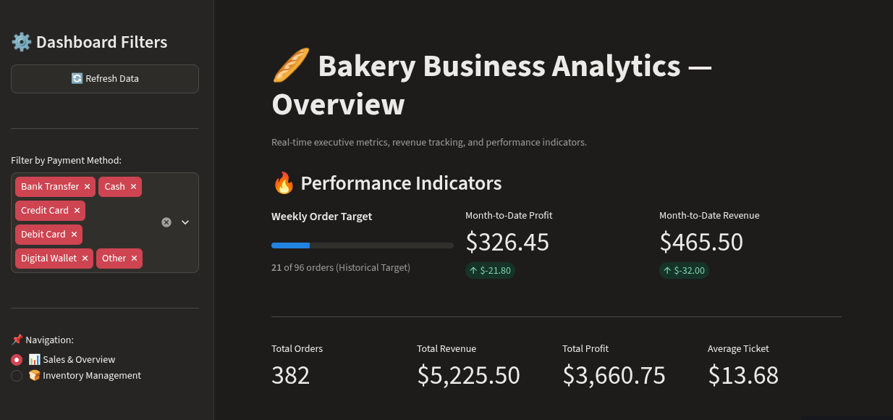
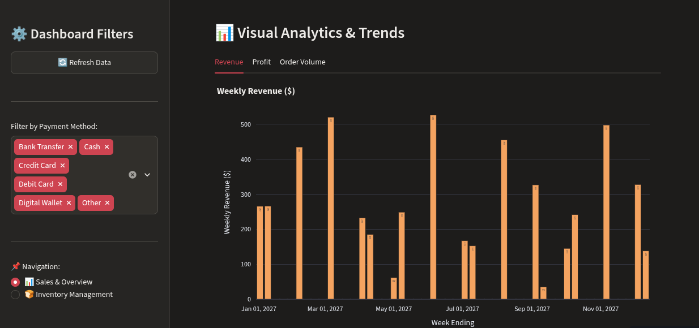

# Bakery Analytics Dashboard

A lightweight financial analytics dashboard built with **Python and Streamlit**, designed to transform Google Sheets sales records into actionable business insights.

The application provides an interactive overview of a bakery's financial performance, tracking key performance indicators (KPIs), monitoring weekly sales trends, and identifying historical sales records — all through a simple and intuitive interface.

## Overview

Small businesses often rely on spreadsheets to manage their daily operations and track financial performance. While accessible, raw spreadsheet data can make it difficult to identify trends, monitor profitability, and evaluate business performance over time.

This project addresses that challenge by connecting directly to Google Sheets and automatically transforming sales records into meaningful visualizations and financial metrics.

Rather than relying on centralized Business Intelligence platforms, such as Power BI, this solution offers a lightweight and flexible alternative that can be deployed to a cloud server or hosted locally on a company's own infrastructure.

## Features

### Financial Overview

The dashboard provides a consolidated view of the bakery's financial performance through key indicators, including:

- **Total Orders:** Number of recorded sales orders.
- **Total Revenue:** Gross revenue generated from sales.
- **Total Profit:** Profit calculated from recorded sales and costs.
- **Average Ticket:** Average revenue per order.

Additional metrics and analytical insights help provide a broader understanding of business performance.

### Weekly Sales Tracking

Monitor sales performance over time through interactive visualizations.

- Track weekly sales activity.
- Analyze revenue trends.
- Compare performance across different periods.
- Identify changes in sales patterns.

### Historical Performance Records

The dashboard also highlights historical sales milestones, including a preview of the week with the highest recorded sales.

This provides a quick reference for identifying particularly successful periods and understanding the business's historical performance.

## Screenshots

### Financial Overview

The main dashboard presents the most relevant financial indicators in a consolidated view, allowing users to quickly assess the business's overall performance.

<!-- Screenshot 1: Main dashboard -->


<!-- Screenshot 2: Additional dashboard view -->


### Sales Analytics

Weekly sales visualizations and historical performance records provide additional insight into sales activity and business trends.

<!-- Additional screenshots can be added here as the project evolves. -->

## Technology Stack

The project was developed using the following technologies:

- **Python** — Core programming language.
- **Streamlit** — Interactive web application framework.
- **Pandas** — Data processing and manipulation.
- **Plotly** — Data visualization and interactive charts.
- **Google Sheets API** — Data source and spreadsheet integration.
- **Google Cloud** — API authentication and service account management.

## Architecture and Data Flow

The application follows a straightforward data pipeline:

1. **Data Source:** Sales records are maintained in a Google Sheets spreadsheet.
2. **Authentication:** The application authenticates with Google services using protected credentials.
3. **Data Retrieval:** The spreadsheet data is retrieved and loaded into the application.
4. **Processing:** Python and Pandas handle data transformation, calculations, and aggregation.
5. **Visualization:** Streamlit and Plotly present the processed information through interactive dashboard components.

This approach keeps data management relatively simple while providing a flexible foundation for future improvements.

## Privacy and Deployment

One of the project's main design considerations is reducing dependence on centralized third-party Business Intelligence platforms.

Although this demonstration is deployed using Streamlit's hosting infrastructure, the application can also be deployed on a private server or run locally within a company's environment.

This provides greater control over the application infrastructure and deployment environment.

### Credential Management

Sensitive credentials are kept outside the application's source code.

The project uses Streamlit's secrets management mechanism through `.streamlit/secrets.toml` to store authentication information required for Google Sheets and Google Cloud integration.

The following security practices should be observed:

- Never commit `secrets.toml` or other files containing credentials.
- Include sensitive configuration files in `.gitignore`.
- Use a dedicated Google Cloud service account with only the permissions required by the application.
- Restrict spreadsheet access to authorized service accounts.
- Avoid exposing API credentials or private configuration data in logs or public repositories.

**Important:** Protecting credentials prevents unauthorized access through exposed secrets, but it does not automatically guarantee data privacy. The hosting environment, application access controls, network configuration, and Google Sheets sharing permissions must also be properly configured.

## Local Installation

The application can be executed locally, making it possible to use the dashboard without relying on a public hosting service.

### Prerequisites

- Python 3.10 or newer.
- A Google Cloud service account.
- Google Sheets API enabled in the associated Google Cloud project.
- Access to the spreadsheet used as the application's data source.

### 1. Clone the repository

```bash
git clone https://github.com/YOUR_USERNAME/YOUR_REPOSITORY.git
cd YOUR_REPOSITORY
```

### 2. Create a virtual environment

```bash
python -m venv .venv
```

Activate it:

**Linux / macOS**

```bash
source .venv/bin/activate
```

**Windows**

```bash
.venv\Scripts\activate
```

### 3. Install dependencies

```bash
pip install -r requirements.txt
```

### 4. Configure Google credentials

Create a `secrets.toml` file inside the `.streamlit/` directory:

```text
.streamlit/
└── secrets.toml
```

Add the required Google Cloud service account credentials and application configuration.

The exact configuration structure must match the authentication method implemented in the application.

**Never upload this file to GitHub.**

### 5. Run the application

```bash
streamlit run app.py
```

Once started, Streamlit will provide a local URL through which the dashboard can be accessed.

## Project Structure

```text
dashboard_streamlit_bakery/
│
├── .streamlit/
│   ├── config.toml
│   └── secrets.toml
│
├── app.py
├── requirements.txt
├── .gitignore
└── README.md
```

*Note: This is an illustrative structure. Adapt it to the actual repository organization.*

## Future Improvements

The dashboard is an ongoing project, with potential improvements including:

- Additional financial indicators and performance metrics.
- More advanced filtering and historical comparisons.
- Improved data validation and error handling.
- Expanded sales and product-level analytics.
- Additional visualizations and reporting capabilities.

## Motivation

This project was developed to address a practical business need: making financial information more accessible and useful for day-to-day decision-making in a small bakery.

It also explores how open-source Python tools can provide a flexible alternative to traditional Business Intelligence platforms, allowing small businesses to build their own analytical infrastructure with greater control over deployment and data access.

---

**Built with Python, Streamlit, and a passion for turning raw data into useful business insights.**
